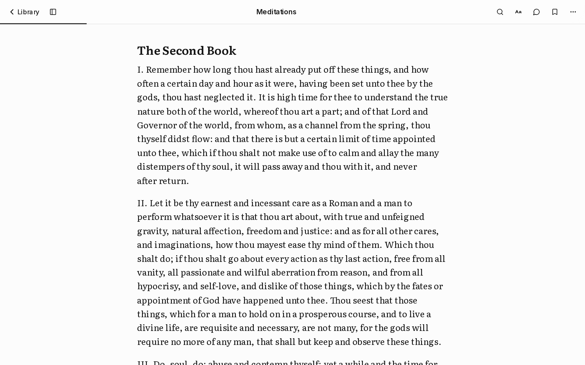

# Paperless

**Try it at [onpaperless.vercel.app](https://onpaperless.vercel.app).** Your books stay in your browser; nothing is uploaded anywhere.

A reader for PDFs and EPUBs that turns them into clean pages you can read on a phone. I built it because I read a lot of books as PDFs, and every PDF reader I tried either showed me a tiny fixed page or a wall of broken text.

<p>
  
  &nbsp;
  
</p>

## What it does

- **Reads the book's structure, not just its text.** Chapters come from the PDF's outline and are matched to the headings on the page. Drop caps join their word again, epigraphs keep their credit line, and italics come from the font names in the file. Running heads and page numbers are removed. Praise, copyright and similar pages are hidden, with one tap in the contents to show them.
- **Pages that fit the screen.** Each page is a screen of text you scroll, with a large Next button at the end that names the next chapter. Chapters always start a new page.
- **EPUB and HTML books.** EPUBs are unzipped and read in the browser. Free books from Project Gutenberg come in through their HTML editions, which already mark chapters, quotes and verse.
- **Discover.** Search Open Library and Project Gutenberg, or describe what you want to read and get suggestions. Every suggestion is looked up in Open Library first, so a book the model made up never shows.
- **Your books stay on your device.** There are no accounts. The library lives in IndexedDB, and you can back it up to a file and restore it.

## What AI does

The AI never writes any of the book. For each page it gets the paragraphs with ids and answers with labels only: this paragraph is a heading, that one is a quote, this one is a stray page number to hide. It can also point at up to two key passages, which must be exact quotes from the paragraph.

The server and the client both check every answer. Unknown ids are dropped. Passages that aren't word-for-word substrings of the page are dropped. Headings that came from the book's own contents can't be changed, and if the AI tries to hide more than a third of a page, none of its hiding is applied. "Show original" is on every page the AI touched.

An earlier version asked the model to rewrite each page as clean text. A rewrite can paraphrase, or come back in a different language than the book's, and the reader has no way to tell. Labels can be wrong, but they can't put words in an author's mouth.

## Running it

```bash
pnpm install
cp .env.example .env.local   # every key is optional
pnpm dev
```

Without any keys the reader works fully and the AI features ask for a key. Readers can add their own Gemini key in Appearance › Pages and AI; it stays in their browser.

With the site's own keys, `AI_DAILY_LIMIT` caps the total AI requests per day, and each person gets an hourly allowance per feature. The counters live in memory, so on a serverless host each instance counts on its own. That's a rough guard against a runaway bill, not exact accounting.

## Tests

```bash
pnpm lint
pnpm typecheck
pnpm test        # Playwright, on an iPhone viewport and a desktop one
```

The end-to-end suite runs against the production build, the same way it runs in CI. The tests make their own books (a PDF printed by the browser, an EPUB zipped in memory, a Gutenberg-style page), so the repo has no copyrighted text in it. The AI is mocked with answers that include a made-up passage, which the reader must reject.

## Layout

| Path | What's there |
| --- | --- |
| `lib/pdf-processor.ts` | PDF lines to paragraphs, headings, quotes, emphasis, front and back matter, and pages |
| `lib/html-processor.ts` | The same for HTML books |
| `lib/epub-processor.ts` | EPUB to one HTML book, with chapter titles from its own contents |
| `lib/import.ts` | Every way a book gets into the library |
| `hooks/use-page-cleanup.ts` | The background AI page check, and the checks on its answers |
| `lib/ai-access.ts` | Which key pays for an AI request, and the limits |
| `components/reader` | The reader: page, toolbars, contents, search, appearance, chat |
| `app/api` | Downloading linked files, Gutenberg books and Open Library data, and the AI routes |
| `app/(site)`, `proxy.ts` | The public pages; `/` shows the library after you add a book |
| `docs/brand` | The app icon sources. The mark is a page with its corner lifting, like the reader's page turn |

Built with Next.js, React, Tailwind CSS, Radix, pdf.js, Dexie and the AI SDK (Gemini and Groq). The toolbars hide while you read. Controls are sized for touch, and appearance settings open in a sheet on phones or a panel on desktop. Pages touched by AI say what changed and keep a link to the original.

## License

MIT
