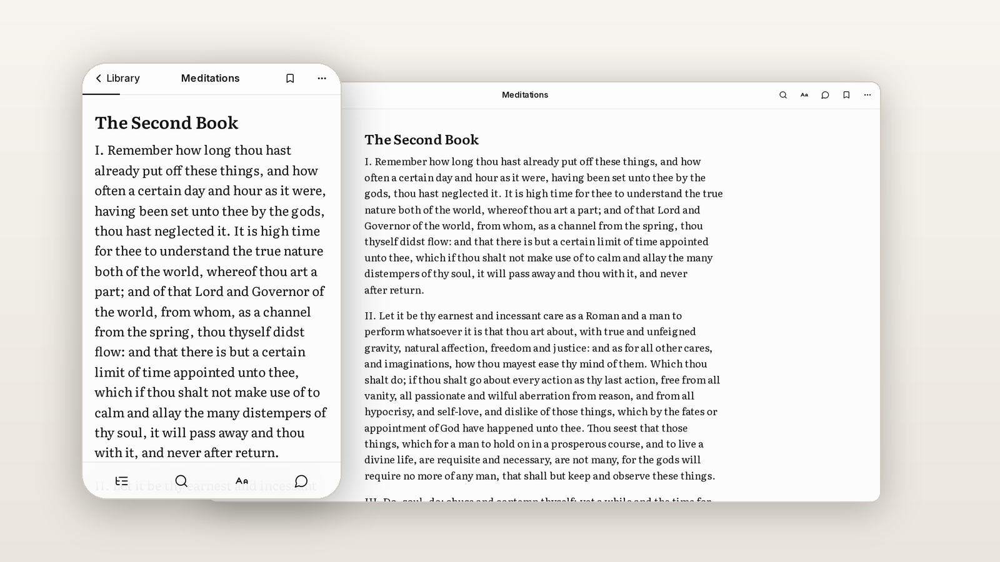

<div align="center">
  

  # Paperless

  **A reader that turns PDFs and EPUBs into pages that actually fit your screen.**

  [**Try it →**](https://onpaperless.vercel.app)

  

  <a href="https://github.com/itamarhanan/paperless/actions/workflows/ci.yml"></a>
  <a href="https://nextjs.org"></a>
  <a href="LICENSE"></a>
  <a href="https://www.playwright.dev"></a>
  
</div>

<br>

> [!NOTE]
> Your books stay in your browser. Nothing is uploaded, there are no accounts, and a backup is one file you own.

[Why](#why) · [Features](#features) · [How the AI stays honest](#how-the-ai-stays-honest) · [Running it](#running-it) · [Tests](#tests) · [Layout](#layout)

## Why

I read a lot of books as PDFs, and every PDF reader I tried showed me either a tiny fixed page or a wall of broken text. That's because a PDF is a print layout, and a phone isn't paper. Instead of showing the print layout, Paperless reads the file's structure, its outline, headings and fonts, and sets the text again as pages the size of your screen.

## Features

- **Pages that fit.** Each page is one screen of text, ending in a large Next button that names the next chapter.
- **Real chapters.** They come from the PDF's own outline, matched to the headings on the page.
- **The print details, kept.** Drop caps join their word again, epigraphs keep their credit line, and italics come from the font names in the file.
- **The print noise, gone.** The reader drops running heads and page numbers, and hides praise and copyright pages until you ask for them from the contents.
- **EPUB and Gutenberg.** The browser unzips an EPUB and reads it. Free Gutenberg books come in through their HTML editions, which already mark chapters, quotes and verse.
- **Discover.** Search Open Library and Project Gutenberg, or describe what you feel like reading. Paperless checks every suggestion against Open Library first, so a book the model made up never shows.
- **AI that only labels.** It marks headings, quotes and stray page numbers. It never writes the book.
- **Local-first.** The library lives in IndexedDB and the app works offline once installed.

## How the AI stays honest

The model never writes the book. For each page it gets the paragraphs with ids, and it answers with labels only: this is a heading, that's a quote, that's a stray page number. Both the server and the browser then check the answer. The checks drop unknown ids and reject quoted passages that don't match the page word for word. Every page the model touched keeps a "Show original" link.

An earlier version asked the model to rewrite each page as clean text. A rewrite can paraphrase, or come back in a different language than the book's, and the reader has no way to tell. Labels can be wrong, but they can't put words in an author's mouth.

## Running it

```bash
pnpm install
cp .env.example .env.local   # every key is optional
pnpm dev
```

Without keys the reader works fully and the AI features ask for one. Readers can add their own Gemini key in Appearance › Pages and AI, and it stays in their browser. `AI_DAILY_LIMIT` caps the site's total AI requests per day, and each person gets a smaller hourly allowance.

## Tests

```bash
pnpm lint && pnpm typecheck
pnpm test    # Playwright, on an iPhone viewport and a desktop one
```

The suite runs against the production build, like CI. The tests make their own books: a PDF printed by the browser, an EPUB zipped in memory, a Gutenberg-style page. No copyrighted text is in the repo. The tests mock the AI with an answer containing a made-up passage, which the reader must reject.

## Layout

| Path | What's there |
| --- | --- |
| `lib/pdf-processor.ts` | PDF lines to paragraphs, headings, quotes, emphasis, front and back matter, and pages |
| `lib/html-processor.ts` | The same for HTML books |
| `lib/epub-processor.ts` | EPUB to one HTML book, with chapter titles from its own contents |
| `lib/import.ts` | Every way a book gets into the library |
| `hooks/use-page-cleanup.ts` | The background AI page check, and the checks on its answers |
| `lib/storage.ts`, `lib/db.ts` | The IndexedDB library: books, settings, reading positions and bookmarks |
| `lib/discover.ts` | Open Library and Gutenberg search, and the check that a suggested book exists |
| `lib/ai-access.ts` | Which key pays for an AI request, and the limits |
| `lib/store/reader-store.ts` | The reader's shared state: open panel, document, AI page labels |
| `hooks/` | Reader behavior: bookmarks, keyboard shortcuts, toolbars that hide while you read |
| `components/reader` | The reader: page, toolbars, contents, search, appearance, chat |
| `app/api` | Downloading linked files, Gutenberg books and Open Library data, and the AI routes |
| `app/(site)`, `proxy.ts` | The public pages; `/` shows the library after you add a book |
| `tests/` | Playwright specs, plus fixtures that build their own PDF, EPUB and Gutenberg books |
| `docs/brand` | Sources of the app icon: a page with its corner lifting, like the reader's page turn |

Built with Next.js, React, Tailwind CSS, Radix, pdf.js, Dexie and the AI SDK with Gemini and Groq.

## License

[MIT](LICENSE)
